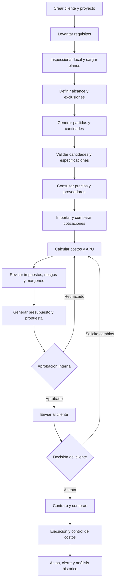

# PRD — Sistema Inteligente de Presupuestos y Proyectos Comerciales
## Nombre provisional: ObraBase AI

**Versión:** 1.0  
**Fecha:** 15 de octubre de 2026  
**Mercado inicial:** Colombia  
**Ciudad inicial:** Bogotá D. C.  
**Vertical inicial:** Droguerías y farmacias  
**Tipo de producto:** SaaS B2B con inteligencia artificial, motor de costos, gestión de proveedores y generación documental  
**Usuarios principales:** Contratistas, empresas de adecuación comercial, arquitectos, ingenieros, diseñadores comerciales, distribuidores de mobiliario y empresas de construcción.

---

# 1. Resumen ejecutivo

## 1.1. Visión del producto

Crear una plataforma que automatice el proceso de convertir un local comercial vacío, en obra gris o parcialmente acondicionado en un proyecto presupuestado, planificado y documentado, listo para que un contratista presente una propuesta integral al cliente.

El sistema debe poder recibir una solicitud como:

> Necesito adecuar un local de 80 m² en Bogotá para convertirlo en una droguería. El local está en obra gris, quiero acabados comerciales estándar, mobiliario, instalaciones eléctricas, iluminación, aire acondicionado, equipos de caja y entrega llave en mano. No incluyas inventario de medicamentos.

A partir de esa descripción, la plataforma debe:

1. Interpretar el alcance del proyecto.
2. Solicitar la información faltante.
3. Crear un modelo estructurado del establecimiento.
4. Identificar los trabajos, materiales, equipos y servicios necesarios.
5. Calcular cantidades preliminares.
6. Consultar bases de precios, catálogos y proveedores.
7. Registrar fuentes, fechas, condiciones y nivel de confianza de cada precio.
8. Solicitar y comparar cotizaciones reales.
9. Calcular costos directos, costos indirectos, contingencias, utilidad e impuestos.
10. Identificar requisitos técnicos, comerciales y regulatorios pendientes.
11. Generar un presupuesto detallado y una propuesta comercial llave en mano.
12. Gestionar revisiones, aprobación del cliente, compras, ejecución y cierre del proyecto.

El resultado no debe ser únicamente un archivo Excel o PDF. Debe ser un sistema de información que mantenga trazabilidad entre los requisitos, las cantidades, los precios, las cotizaciones, los cálculos y la propuesta final.

## 1.2. Problema que resuelve

Actualmente, elaborar un presupuesto de adecuación comercial requiere combinar manualmente:

- Planos y mediciones del inmueble.
- Conocimientos de construcción e instalaciones.
- Bases de análisis de precios unitarios (APU).
- Catálogos de materiales y equipos.
- Búsquedas en tiendas y sitios web.
- Cotizaciones de fabricantes y distribuidores.
- Cálculos de mano de obra, transporte e instalación.
- Gastos administrativos y utilidad.
- Tratamiento tributario del contrato.
- Requisitos regulatorios aplicables.
- Hojas de cálculo y documentos comerciales.

Este proceso es lento, propenso a errores y difícil de auditar. Además, una cifra aparentemente precisa puede estar basada en estimaciones que nunca fueron verificadas con un proveedor.

ObraBase AI busca convertir este proceso en un flujo reproducible, auditable y asistido por inteligencia artificial.

## 1.3. Propuesta de valor

**Para el contratista:** reducir el tiempo de preparación de presupuestos, mejorar la precisión de los costos y controlar el margen del proyecto.

**Para el cliente:** recibir una propuesta desglosada, transparente y comparable, con un alcance claramente definido.

**Para el equipo de ejecución:** disponer de cantidades, especificaciones, compras, entregables y cambios centralizados.

**Para la dirección de la empresa:** conocer el costo estimado, el precio de venta, la utilidad prevista, los riesgos y las desviaciones durante la ejecución.

---

# 2. Objetivos y resultados esperados

## 2.1. Objetivos principales

1. Automatizar la preparación de presupuestos comerciales desde una descripción inicial.
2. Construir una base de precios de materiales, mano de obra, equipos y servicios por región.
3. Distinguir sistemáticamente entre precios publicados, referencias estadísticas, estimaciones y cotizaciones confirmadas.
4. Generar cantidades y APU con fórmulas verificables.
5. Facilitar la adquisición de cotizaciones reales.
6. Calcular costos, contingencias, utilidad e impuestos con reglas configurables.
7. Generar propuestas profesionales listas para revisión y envío.
8. Mantener trazabilidad desde el requisito original hasta la factura y el costo real.
9. Aprender de los proyectos ejecutados para mejorar futuras estimaciones.
10. Permitir que un profesional valide los aspectos técnicos, comerciales y regulatorios que no deben decidirse de manera autónoma.

## 2.2. Indicadores de éxito

Las siguientes son metas iniciales que deben validarse mediante pilotos.

| Indicador | Meta inicial |
|---|---:|
| Tiempo para preparar un primer presupuesto | Menos de 30 minutos para un proyecto estándar |
| Tiempo de elaboración con cantidades completas y planos | Reducir al menos 60% frente al proceso manual |
| Partidas con fuente de precio registrada | 100% |
| Partidas identificadas explícitamente como estimadas | 100% |
| Cálculos monetarios reproducibles | 100% |
| Partidas duplicadas detectadas antes de aprobar | Más del 95% de las duplicaciones conocidas |
| Propuestas generadas sin errores aritméticos | 100% |
| Cotizaciones vencidas identificadas | 100% de las cotizaciones con fecha de vigencia registrada |
| Diferencia entre costo estimado y costo real | Medir desde el primer proyecto y reducir progresivamente |
| Tiempo de preparación de una revisión comercial | Menos de 10 minutos, excluyendo validaciones externas |

El sistema no debe prometer precisión de costos antes de disponer de datos históricos suficientes. Las metas de desviación presupuestaria se establecerán tras ejecutar proyectos piloto.

---

# 3. Usuarios y perfiles

## 3.1. Administrador de la organización

Responsabilidades:

- Configurar la empresa y sus datos fiscales.
- Definir políticas de costos, márgenes y aprobaciones.
- Gestionar usuarios y permisos.
- Configurar catálogos y proveedores.
- Administrar plantillas de presupuestos y contratos.
- Consultar indicadores financieros y operativos.

## 3.2. Presupuestista o analista de costos

Responsabilidades:

- Crear proyectos.
- Registrar cantidades.
- Consultar y validar precios.
- Crear y modificar APU.
- Solicitar cotizaciones.
- Revisar márgenes, contingencias e impuestos.
- Generar propuestas.

## 3.3. Arquitecto, ingeniero o profesional técnico

Responsabilidades:

- Revisar planos y mediciones.
- Validar las cantidades estimadas.
- Aprobar las especificaciones técnicas.
- Identificar incompatibilidades.
- Revisar instalaciones y requisitos normativos.
- Aprobar las partidas que requieran conocimiento especializado.

## 3.4. Comprador o encargado de adquisiciones

Responsabilidades:

- Solicitar ofertas.
- Registrar propuestas de proveedores.
- Comparar precios, disponibilidad, plazos y garantías.
- Crear órdenes de compra.
- Registrar entregas y facturas de proveedores.

## 3.5. Gerente comercial

Responsabilidades:

- Revisar la propuesta.
- Configurar condiciones comerciales autorizadas.
- Aprobar el precio final y el margen.
- Enviar la oferta al cliente.
- Gestionar revisiones y negociaciones.

## 3.6. Cliente

Responsabilidades:

- Proporcionar información del local.
- Revisar el alcance.
- Aprobar el presupuesto.
- Solicitar cambios.
- Aceptar la propuesta y los entregables.

El cliente debe acceder solamente a la información compartida con él. No debe tener acceso automático a costos internos, márgenes confidenciales ni ofertas confidenciales de otros proveedores.

---

# 4. Alcance del producto

## 4.1. Alcance del MVP

La primera versión comercial debe incluir:

- Gestión de organizaciones, usuarios y permisos.
- Gestión de clientes y proyectos.
- Formulario inteligente de levantamiento de requerimientos.
- Registro de dimensiones y características del inmueble.
- Catálogo de capítulos, partidas, materiales, equipos y servicios.
- Base de precios con fuentes y fechas.
- Importación de listas de precios y cotizaciones mediante Excel, CSV y PDF.
- Extracción asistida por IA de información de documentos.
- Cálculo de cantidades y APU.
- Solicitud y comparación de cotizaciones.
- Motor de costos, márgenes y contingencias.
- Motor fiscal configurable con revisión profesional.
- Generación de presupuesto en Excel y PDF.
- Generación de propuesta comercial.
- Registro de revisiones y aprobaciones.
- Gestión de exclusiones, riesgos y datos pendientes.
- Historial de cambios y auditoría.

## 4.2. Alcance de la segunda fase

- Lectura avanzada de planos PDF y extracción de dimensiones.
- Procesamiento de planos CAD/BIM.
- Integraciones con proveedores y catálogos mediante API.
- Portal de proveedores para responder cotizaciones.
- Gestión de compras y órdenes de compra.
- Control presupuestario durante la ejecución.
- Comparación entre costo presupuestado y costo real.
- Facturas y pagos de proveedores.
- Gestión de actas de avance y cubicaciones.
- Integración con herramientas contables y de facturación.
- Firma electrónica a través de un proveedor compatible.

## 4.3. Funcionalidades fuera del MVP

- Compra automática de materiales sin aprobación humana.
- Emisión autónoma de conceptos legales o tributarios definitivos.
- Certificación automática de cumplimiento sanitario.
- Diseño arquitectónico completamente autónomo sin revisión.
- Control físico de obras mediante sensores.
- Administración del inventario de medicamentos como sistema farmacéutico independiente.
- Ejecución automática de pagos a proveedores.

Estas funcionalidades podrán evaluarse después de validar el producto principal.

---

# 5. Flujo integral del sistema

El proceso debe modelarse como un flujo de estados explícitos, con validaciones antes de avanzar.

## 5.1. Estados del proyecto

- `DRAFT`: borrador.
- `DISCOVERY`: recopilación de requisitos.
- `SITE_SURVEY_PENDING`: visita técnica pendiente.
- `SCOPE_REVIEW`: alcance en revisión.
- `QUANTITY_TAKEOFF`: elaboración de cantidades.
- `PRICING`: recopilación de precios.
- `QUOTATION_PENDING`: cotizaciones pendientes.
- `COST_REVIEW`: revisión económica.
- `TECHNICAL_REVIEW`: revisión técnica.
- `TAX_REVIEW`: revisión fiscal.
- `INTERNAL_APPROVAL`: aprobación interna.
- `PROPOSAL_SENT`: propuesta enviada.
- `NEGOTIATION`: negociación.
- `ACCEPTED`: aceptado.
- `CONTRACTED`: contratado.
- `IN_EXECUTION`: en ejecución.
- `CLOSED`: cerrado.
- `CANCELLED`: cancelado.

El sistema debe impedir que una propuesta pase a estado `APPROVED` si existen errores aritméticos, partidas obligatorias sin valorar, datos fiscales críticos pendientes o aprobaciones requeridas sin completar.

Una propuesta puede aprobarse con precios estimados únicamente si la política de la organización lo permite y el documento identifica claramente esas estimaciones.

---

# 6. Módulo 1: creación y levantamiento del proyecto

## 6.1. Datos generales

Cada proyecto debe contener:

- Nombre comercial.
- Código único.
- Cliente.
- NIT o identificación fiscal, cuando corresponda.
- Ciudad, departamento y país.
- Dirección del inmueble.
- Tipo de establecimiento.
- Área estimada y área medida.
- Estado actual del local.
- Tipo de contrato previsto.
- Fecha de inicio deseada.
- Fecha de entrega deseada.
- Presupuesto máximo del cliente, opcional.
- Nivel de acabado.
- Responsable comercial.
- Responsable técnico.
- Moneda.
- Versión del presupuesto.
- Estado del proyecto.

## 6.2. Asistente de levantamiento

El sistema debe permitir introducir los requisitos mediante:

1. Formulario estructurado.
2. Texto libre.
3. Conversación con un asistente de IA.
4. Importación de documentos.
5. Fotografías del local.
6. Planos PDF y, posteriormente, archivos CAD/BIM.
7. Plantillas específicas por tipo de establecimiento.

El asistente convierte las respuestas en campos estructurados y solicita únicamente los datos que falten y que sean relevantes.

### Ejemplo de preguntas adaptativas

- ¿El local está en obra gris o ya tiene pisos y cielo raso?
- ¿Qué área tiene?
- ¿Hay baño funcional?
- ¿Existe acometida eléctrica adecuada?
- ¿Cuántas cajas registradoras tendrá?
- ¿Cuántas paredes necesitan estanterías?
- ¿Se requiere mobiliario central?
- ¿Qué productos requieren refrigeración?
- ¿Se incluirá inventario inicial?
- ¿El proyecto debe entregarse llave en mano?
- ¿El cliente exige marcas o proveedores específicos?

El sistema debe distinguir entre una respuesta confirmada y una inferencia de IA.

## 6.3. Matriz de completitud

Cada proyecto tendrá una matriz de información:

| Dato | Estado | Acción |
|---|---|---|
| Área del local | Confirmado | Ninguna |
| Altura libre | Pendiente | Medir |
| Estado de redes | Por verificar | Inspección técnica |
| Tipo de piso | Supuesto | Validar con cliente |
| Distribución de estanterías | Pendiente | Crear plano |
| Necesidad de refrigeración | Pendiente | Confirmar productos |
| Condición tributaria del contrato | Pendiente | Revisar con contador |

El sistema podrá generar un presupuesto preliminar antes de completar todos los datos, pero debe indicar las hipótesis utilizadas y sus posibles consecuencias económicas.

---

# 7. Módulo 2: alcance técnico y estructura de partidas

## 7.1. Catálogo jerárquico

El sistema debe disponer de una estructura estándar:

- Proyecto.
  - Capítulo.
    - Partida.
      - Recurso.
        - Material.
        - Mano de obra.
        - Equipo.
        - Transporte.
        - Subcontrato.
        - Servicio.
        - Consumible.

Cada partida tendrá un código único, descripción, unidad de medida, especificaciones y reglas de cálculo.

## 7.2. Catálogo inicial para droguerías

### Capítulo 01 — Estudios y diseño

- Visita técnica.
- Levantamiento arquitectónico.
- Diseño de distribución.
- Planos arquitectónicos.
- Diseño eléctrico.
- Diseño de iluminación.
- Diseño de red de datos.
- Diseño de mobiliario.
- Coordinación técnica.

### Capítulo 02 — Preliminares

- Protección de áreas.
- Desmonte y retiro de elementos.
- Demolición, cuando corresponda.
- Transporte de escombros.
- Disposición autorizada de residuos.
- Preparación de superficies.
- Limpieza inicial.

### Capítulo 03 — Obra civil y acabados

- Nivelación de pisos.
- Suministro e instalación de pisos.
- Zócalos.
- Resanes.
- Estuco.
- Pintura.
- Divisiones.
- Puertas.
- Cielo raso.
- Adecuaciones de baño.
- Reparación de muros.

### Capítulo 04 — Electricidad e iluminación

- Tablero eléctrico.
- Protecciones.
- Cableado.
- Canalizaciones.
- Tomas de corriente.
- Circuitos dedicados.
- Luminarias.
- Iluminación de emergencia.
- Puesta a tierra, cuando aplique.
- Pruebas y certificaciones requeridas.

### Capítulo 05 — Climatización

- Cálculo de carga térmica.
- Equipos de aire acondicionado.
- Soportes.
- Tuberías y aislamiento.
- Drenajes.
- Cableado.
- Instalación.
- Pruebas.
- Mantenimiento inicial.

### Capítulo 06 — Red, seguridad y tecnología

- Cableado estructurado.
- Gabinete de comunicaciones.
- Switches.
- Puntos de red.
- Cámaras.
- Grabador y almacenamiento.
- Alarma.
- Control de acceso, cuando se requiera.
- UPS.
- Configuración.

### Capítulo 07 — Mobiliario comercial

- Góndolas murales.
- Góndolas centrales.
- Estanterías.
- Mostrador de caja.
- Mostrador de atención.
- Vitrinas.
- Cajoneras.
- Muebles de almacenamiento.
- Muebles de oficina.
- Transporte.
- Montaje y nivelación.

### Capítulo 08 — Equipamiento de farmacia

- Equipos de refrigeración cuando sean necesarios.
- Instrumentos de medición y monitoreo.
- Elementos de almacenamiento.
- Contenedores o accesorios específicos.
- Equipos auxiliares requeridos por el alcance.

La selección debe depender de los productos y de los requisitos aplicables; no se debe añadir equipamiento farmacéutico innecesario por defecto.

### Capítulo 09 — Punto de venta

- Computador.
- Monitor.
- Lector de códigos.
- Impresora de recibos.
- Impresora de etiquetas, si corresponde.
- Cajón monedero.
- UPS.
- Licencia de software.
- Configuración.
- Integración con facturación electrónica.

### Capítulo 10 — Imagen comercial

- Diseño de identidad visual, si está incluido.
- Aviso exterior.
- Señalización.
- Señalización de seguridad.
- Gráficos de escaparate.
- Elementos decorativos.
- Instalación.

### Capítulo 11 — Entrega y cierre

- Pruebas eléctricas.
- Pruebas de climatización.
- Pruebas de equipos.
- Limpieza final.
- Manuales.
- Garantías.
- Inventario de activos instalados.
- Acta de entrega.
- Capacitación al personal, si está incluida.

## 7.3. Reglas para evitar partidas omitidas y duplicadas

El sistema debe identificar:

- Materiales incluidos ya en una partida instalada.
- Transporte incluido en el precio de proveedor.
- Mano de obra duplicada en un APU y en un subcontrato.
- Equipos repetidos en capítulos diferentes.
- Elementos que se venden como kit.
- Trabajos que dependen de otra partida.
- Costos que no están incluidos en el alcance.

Cada partida podrá tener una relación de dependencias y una lista de inclusiones/exclusiones.

---

# 8. Módulo 3: mediciones y cálculo de cantidades

## 8.1. Motor de cantidades

El sistema calculará cantidades utilizando reglas explícitas.

Ejemplos:

- Piso: largo × ancho.
- Pintura: suma de superficies de muros menos aberturas, según el método de medición adoptado.
- Cielo raso: superficie horizontal.
- Zócalos: perímetro aplicable menos aberturas.
- Luminarias: cantidad calculada a partir del diseño de iluminación aprobado.
- Tomas: cantidad según plano eléctrico.
- Estanterías: número de módulos que caben según distribución y dimensiones reales.
- Cableado: longitud de recorridos, con una provisión de desperdicio o reserva definida por regla.
- Aire acondicionado: capacidad calculada mediante evaluación térmica, no únicamente por área.
- CCTV: cantidad y ubicación según cobertura requerida.

## 8.2. Fórmulas y parámetros

Cada cálculo debe almacenar:

- Fórmula.
- Parámetros de entrada.
- Unidad de medida.
- Resultado sin redondear.
- Regla de redondeo.
- Porcentaje de desperdicio.
- Fuente de los parámetros.
- Usuario que lo aprobó.
- Fecha de cálculo.
- Versión de la fórmula.

Ejemplo:

`Cantidad de piso = área medida × (1 + porcentaje de desperdicio)`

Si el área es de 80 m² y se configura un desperdicio del 8%, la cantidad de compra será de 86,4 m², sujeta a las reglas de empaque y presentación del proveedor.

El sistema debe conservar por separado la cantidad instalada y la cantidad de compra. No debe utilizar automáticamente la cantidad con desperdicio para facturar una cantidad de obra ejecutada.

## 8.3. Gestión de planos

Para el MVP, el usuario podrá cargar planos PDF y registrar mediciones manuales.

La extracción automática de dimensiones se incorporará posteriormente con estas reglas:

- Detectar la escala cuando exista información suficiente.
- Solicitar confirmación de escala.
- Mostrar la geometría utilizada.
- Registrar la confianza de la extracción.
- No inferir dimensiones exactas a partir de fotografías sin calibración.
- Permitir corregir todas las mediciones.

Las cantidades extraídas automáticamente de planos no se considerarán aprobadas hasta que el usuario autorizado las valide.

---

# 9. Módulo 4: motor de precios y fuentes

Este es uno de los módulos más importantes del producto.

## 9.1. Tipos de precio

Cada precio debe pertenecer a una categoría explícita:

### A. Precio publicado

Precio visible en una tienda, catálogo o página de proveedor.

Debe almacenar:

- Producto.
- Precio.
- Moneda.
- URL.
- Proveedor.
- Fecha de consulta.
- Impuestos indicados.
- Disponibilidad observada, si existe.
- Condiciones de transporte.
- Evidencia documental.

Un precio visible no demuestra por sí solo que el producto esté disponible para entrega inmediata.

### B. Precio de referencia

Procedente de una base de costos, un APU, una publicación estadística o una referencia histórica.

Debe almacenar:

- Fuente.
- Edición o periodo.
- Ciudad o región.
- Unidad.
- Condiciones de cálculo.
- Fecha de vigencia.
- Limitaciones.

### C. Cotización real

Propuesta comercial recibida de un proveedor.

Debe almacenar:

- Número de cotización.
- Proveedor.
- Fecha de emisión.
- Fecha de vencimiento.
- Cantidad cotizada.
- Precio unitario.
- Impuestos.
- Transporte.
- Instalación.
- Garantía.
- Tiempo de entrega.
- Forma de pago.
- Exclusiones.
- Documento original.

Una cotización no debe etiquetarse como confirmada si solo existe una conversación informal sin condiciones suficientes.

### D. Estimación interna

Precio calculado a partir de parámetros, experiencias previas o un modelo de estimación.

Debe almacenar:

- Método de estimación.
- Variables utilizadas.
- Fuente de los parámetros.
- Nivel de confianza.
- Justificación.
- Responsable de aprobación.

### E. Costo real histórico

Precio derivado de una factura, una compra ejecutada o un costo registrado durante un proyecto.

Debe distinguirse entre precio facturado, costo contabilizado y costo efectivamente pagado.

## 9.2. Fuentes iniciales para Colombia

El sistema debe admitir la incorporación de estas fuentes:

| Fuente | Uso |
|---|---|
| Construdata | Costos de construcción, materiales y APU, según cobertura contratada |
| SISPAC | Bases de recursos y APU por región |
| DANE | Índices oficiales para analizar variaciones y actualizar referencias |
| Colombia Compra Eficiente | Antecedentes públicos de contratación y referencias de precios cuando los datos estén disponibles |
| Industrias Cruz MR | Mobiliario para droguerías |
| BP Formas | Estanterías y mobiliario comercial |
| E-commerce de equipos POS | Computadores, impresoras y periféricos |
| Distribuidores de climatización | Equipos e instalaciones |
| Proveedores locales | Materiales, mano de obra, transporte y servicios |
| Historial interno | Costos reales de proyectos ejecutados |

Los conectores deberán comprobar la disponibilidad de datos, los permisos de acceso y las condiciones de uso de cada fuente.

El sistema no debe asumir que todos los proveedores permiten extracción automatizada de sus páginas.

## 9.3. Arquitectura de conectores de precios

Crear una interfaz común:

`PriceSourceConnector`

Operaciones:

- `searchProducts(query, location)`
- `getProductDetails(sourceProductId)`
- `getPublishedPrice(sourceProductId)`
- `getAvailability(sourceProductId)`
- `getSourceMetadata(sourceProductId)`
- `importCatalog(file)`
- `normalizePrice(rawPrice)`
- `validateSourceEvidence(sourceRecord)`

Cada conector puede implementar solo las operaciones que realmente soporte.

Los métodos no soportados deben devolver un estado explícito, no datos simulados.

## 9.4. Estrategia de adquisición de datos

Orden de preferencia:

1. API oficial del proveedor.
2. Catálogo o archivo descargable autorizado.
3. Feed comercial.
4. Importación de Excel o CSV.
5. Extracción de documentos recibidos.
6. Consulta de páginas públicas, respetando sus términos de uso.
7. Registro manual de cotizaciones.

La plataforma debe evitar depender exclusivamente de scraping, ya que los sitios cambian, bloquean solicitudes o modifican su estructura.

## 9.5. Modelo de precio normalizado

Todos los precios deben normalizarse a una estructura común:

- Producto o servicio.
- Especificación.
- Unidad comercial.
- Unidad de medición del proyecto.
- Cantidad mínima de compra.
- Precio antes de impuestos, si está disponible.
- Impuestos.
- Precio final publicado.
- Descuento.
- Transporte.
- Instalación.
- Costo de conversión de unidad.
- Moneda.
- Fecha.
- Vigencia.
- Ubicación.
- Disponibilidad.
- Fuente.
- Nivel de confianza.

El precio de compra de un producto no debe confundirse con su costo instalado.

## 9.6. Comparación de precios

Cuando existan varios precios válidos, el sistema podrá mostrar:

- Precio más bajo.
- Precio mediano.
- Precio más reciente.
- Precio promedio ponderado.
- Precio histórico.
- Precio con transporte incluido.
- Precio instalado.
- Precio con impuestos incluidos.
- Precio recomendado para presupuesto.

La selección no debe hacerse exclusivamente por precio mínimo. Debe considerar equivalencia técnica, calidad, disponibilidad, garantía, logística y vigencia.

## 9.7. Actualización de precios

Cada categoría tendrá una política de antigüedad configurable.

Ejemplo inicial de políticas internas:

- Cotizaciones: vigencia indicada por el proveedor.
- Precios publicados: revalidación sugerida cada 7–30 días según volatilidad.
- Mano de obra: revisión mensual o trimestral.
- APU: identificar edición y periodo de referencia.
- Índices oficiales: actualizar cuando se publique una nueva edición.

Estas frecuencias son políticas operativas iniciales, no obligaciones legales.

Cuando un precio esté vencido o desactualizado, el sistema debe advertirlo y evitar presentarlo como una oferta vigente.

---

# 10. Módulo 5: gestión de proveedores y cotizaciones

## 10.1. Directorio de proveedores

Cada proveedor tendrá:

- Razón social.
- Nombre comercial.
- NIT, cuando esté disponible.
- Contacto.
- Correo.
- Teléfono.
- Dirección.
- Ciudad.
- Categorías de suministro.
- Cobertura geográfica.
- Condiciones de pago.
- Plazos habituales.
- Garantías.
- Historial de cotizaciones.
- Historial de compras.
- Documentos.
- Estado de verificación.

El sistema distinguirá entre proveedor identificado, proveedor contactado, proveedor cotizante y proveedor aprobado internamente.

## 10.2. Solicitud de cotización (RFQ)

El sistema debe generar solicitudes a partir de las partidas pendientes de precio.

Cada solicitud contendrá:

- Identificación del proyecto.
- Descripción técnica.
- Cantidad.
- Unidad.
- Especificaciones.
- Ubicación de entrega.
- Requisitos de instalación.
- Plazo deseado.
- Garantías requeridas.
- Fecha límite de respuesta.
- Condiciones de impuestos.
- Condiciones de transporte.
- Formato de respuesta.

El usuario podrá enviar la solicitud por correo electrónico, descargarla en PDF o utilizar un portal de proveedores en una fase posterior.

## 10.3. Comparador de ofertas

El comparador debe permitir evaluar ofertas equivalentes.

| Criterio | Ejemplo |
|---|---|
| Precio base | Valor antes de impuestos |
| Impuestos | Valor y tratamiento indicado |
| Transporte | Incluido o separado |
| Instalación | Incluida o separada |
| Tiempo de entrega | Días hábiles |
| Garantía | Meses o condiciones |
| Disponibilidad | Confirmada o pendiente |
| Forma de pago | Anticipo y saldo |
| Cumplimiento técnico | Aprobado, parcial o rechazado |
| Vigencia | Fecha de vencimiento |

El sistema calculará el costo total comparable y explicará cualquier diferencia relevante.

No seleccionará automáticamente una oferta que incumpla especificaciones críticas.

## 10.4. Automatización de comunicaciones

El sistema podrá preparar mensajes para proveedores y recordatorios.

Ejemplo:

> Asunto: Solicitud de cotización — Mobiliario para droguería de 80 m² en Bogotá.
>
> Buen día:
>
> Estamos preparando un proyecto de adecuación integral de una droguería en Bogotá. Solicitamos cotización para estanterías, mostradores y vitrinas según las cantidades y especificaciones adjuntas.
>
> Agradecemos indicar precio unitario, impuestos, transporte, instalación, plazo de entrega, garantía y vigencia de la oferta.
>
> Saludos.

El envío masivo, los recordatorios y cualquier comunicación externa deben estar sujetos a los permisos de la organización y a sus políticas de comunicación.

---

# 11. Módulo 6: motor de APU y cálculo económico

## 11.1. Estructura de un APU

Un análisis de precio unitario debe contener:

- Código.
- Descripción.
- Unidad de la actividad.
- Materiales.
- Mano de obra.
- Equipos y herramientas.
- Transporte.
- Consumibles.
- Rendimientos.
- Desperdicios.
- Subcontratos, cuando proceda.
- Costo directo unitario.
- Fuente de cada recurso.
- Fecha del análisis.
- Versión.

Ejemplo conceptual:

**Partida:** instalación de luminaria LED.

| Recurso | Unidad | Cantidad por luminaria | Precio unitario |
|---|---|---:|---:|
| Panel LED | Unidad | 1 | Precio publicado |
| Cable y conectores | Conjunto | Según diseño | Precio de referencia |
| Técnico electricista | Hora | Según rendimiento | APU o cotización |
| Ayudante | Hora | Según rendimiento | APU o cotización |
| Herramientas y consumibles | Proporción | Según política | Estimación documentada |

El motor calculará el costo unitario y el costo total de la actividad, conservando el detalle de cada componente.

## 11.2. Fórmulas principales

Costo directo de una partida:

`Costo directo = materiales + mano de obra + equipos + transporte + subcontratos + consumibles`

Costo directo del proyecto:

`CD = suma de cantidades × costos directos unitarios`

Precio antes de impuestos:

`Precio base = CD + administración + otros indirectos + contingencia presupuestada + utilidad`

La fórmula exacta debe adaptarse a la política de la empresa y a las condiciones del contrato.

## 11.3. No confundir recargo con margen

El sistema debe ofrecer dos métodos claramente diferenciados.

**Recargo sobre costo:**

`Precio = costo × (1 + recargo)`

**Margen sobre venta:**

`Precio = costo / (1 - margen)`

Por ejemplo, para un costo de $100 y un margen objetivo del 20%:

`Precio = 100 / (1 - 0,20) = 125`

El sistema no debe tratar un recargo del 20% como equivalente a un margen del 20%.

## 11.4. Contingencias

La contingencia se configurará según:

- Estado del inmueble.
- Calidad del levantamiento.
- Incertidumbre de las cantidades.
- Condición de las instalaciones.
- Volatilidad de los precios.
- Disponibilidad de proveedores.
- Plazo de ejecución.

La plataforma debe distinguir entre:

1. Contingencia presupuestada.
2. Contingencia autorizada.
3. Contingencia consumida.
4. Contingencia restante.

La reserva no se debe sumar dos veces ni confundirse con costos ya incorporados en los APU.

## 11.5. Costo instalado

Cada producto tendrá una vista que muestre:

- Precio de compra.
- Transporte.
- Carga y descarga.
- Mano de obra de instalación.
- Materiales auxiliares.
- Herramientas y equipos.
- Pruebas.
- Garantías.
- Impuestos aplicables.

Esto permitirá comparar un producto aparentemente más caro que incluye instalación con otro más barato que exige varios costos adicionales.

---

# 12. Módulo 7: impuestos y reglas contractuales

El tratamiento fiscal debe estar desacoplado del motor de precios y configurarse por país, jurisdicción, tipo de operación y contrato.

## 12.1. Colombia como primera jurisdicción

El sistema deberá contemplar:

- IVA aplicable a bienes y servicios.
- Impuestos incluidos en precios publicados.
- Impuestos separados en cotizaciones.
- Retenciones cuando procedan.
- Diferencias entre suministro, servicios y construcción de inmueble.
- Condición tributaria del proveedor y del contratista.
- Tratamiento de anticipos.
- Documentos y requisitos de facturación.
- Reglas de actualización normativa.

No debe asumir que toda partida está gravada al mismo tipo ni que el IVA se calcula necesariamente sobre el valor total de un contrato mixto.

## 12.2. Motor de reglas fiscales

Cada regla debe registrar:

- Jurisdicción.
- Tipo de operación.
- Condiciones de aplicación.
- Fórmula.
- Base gravable.
- Tasa.
- Fecha de vigencia.
- Fuente normativa.
- Versión.
- Responsable de revisión.
- Estado de aprobación.

El sistema podrá proponer un tratamiento, pero debe marcar como pendiente cualquier caso que requiera clasificación profesional.

## 12.3. Validaciones obligatorias

Antes de emitir una propuesta:

- Verificar si los precios ya incluyen impuestos.
- Evitar duplicar IVA en materiales.
- Separar las partidas con tratamiento distinto cuando sea necesario.
- Mostrar el total antes de impuestos y el total final.
- Registrar las hipótesis fiscales.
- Solicitar aprobación cuando exista ambigüedad.
- Conservar la versión de las reglas utilizada.

El sistema no debe presentar una estimación tributaria como asesoría legal o fiscal definitiva.

---

# 13. Módulo 8: inteligencia artificial

La IA debe asistir en la interpretación, extracción, clasificación y explicación. Los cálculos financieros deben ejecutarse mediante funciones deterministas.

## 13.1. Casos de uso

- Interpretar solicitudes en lenguaje natural.
- Crear un borrador de alcance.
- Proponer capítulos y partidas.
- Extraer productos de catálogos.
- Extraer precios de cotizaciones PDF.
- Detectar datos faltantes.
- Identificar posibles duplicados.
- Comparar especificaciones de proveedores.
- Proponer preguntas para el levantamiento.
- Detectar anomalías en costos.
- Generar descripciones comerciales.
- Redactar propuestas y exclusiones.
- Explicar cambios entre versiones.
- Resumir riesgos técnicos y económicos.

## 13.2. Arquitectura de IA

La capa de IA debe ser independiente del proveedor de modelos.

Interfaces recomendadas:

- `LLMProvider`
- `DocumentExtractionProvider`
- `VisionProvider`
- `EmbeddingProvider`

Esto permitirá usar diferentes modelos según la tarea, el costo, la latencia y los requisitos de privacidad.

Las respuestas de IA deben producir objetos estructurados validados por esquemas. El modelo no tendrá autoridad para modificar directamente precios aprobados, fórmulas fiscales o presupuestos aceptados sin pasar por las validaciones correspondientes.

## 13.3. Confianza y evidencia

Cada dato extraído debe indicar:

- Documento de origen.
- Página o sección.
- Texto relevante.
- Valor extraído.
- Unidad.
- Confianza de extracción.
- Estado de revisión humana.

El sistema debe distinguir entre la confianza del OCR, la confianza en la identificación del producto y la confianza comercial en el precio.

Una extracción con confianza baja se enviará a revisión.

## 13.4. Guardrails

- No inventar precios.
- No inventar disponibilidad.
- No inventar cotizaciones.
- No inventar referencias normativas.
- No convertir una estimación en una oferta confirmada.
- No inferir medidas exactas sin evidencia suficiente.
- No aplicar fórmulas tributarias fuera de su ámbito.
- No enviar comunicaciones externas sin autorización.
- No aprobar compras ni comprometer fondos de manera autónoma.

La IA podrá recomendar una acción, pero el sistema debe registrar quién autorizó la decisión final.

---

# 14. Módulo 9: generación de documentos

El sistema debe generar documentos profesionales con identidad corporativa.

## 14.1. Presupuesto detallado

Contenido:

1. Portada.
2. Datos del proyecto.
3. Alcance.
4. Hipótesis de cálculo.
5. Capítulos.
6. Partidas.
7. Unidades.
8. Cantidades.
9. Precios unitarios.
10. Subtotales.
11. Costos indirectos.
12. Contingencia.
13. Utilidad.
14. Impuestos.
15. Total final.
16. Vigencia.
17. Condiciones comerciales.
18. Exclusiones.
19. Firmas o aprobaciones.

## 14.2. Cuadro de cantidades y precios unitarios

Columnas:

- Código.
- Capítulo.
- Descripción.
- Unidad.
- Cantidad.
- Precio unitario.
- Precio total.
- Fuente de precio.
- Estado de verificación.

Se generará en Excel y PDF.

## 14.3. Informe de fuentes y trazabilidad

Documento interno que detalle:

- Precios publicados.
- Cotizaciones recibidas.
- Referencias APU.
- Estimaciones internas.
- Fechas de consulta.
- Fuentes.
- Precios vencidos.
- Partidas sin cotizar.
- Diferencias entre proveedores.
- Supuestos de cálculo.

Este informe podrá ocultarse de la propuesta comercial si contiene información confidencial.

## 14.4. Propuesta llave en mano

Debe incluir:

- Objetivo.
- Descripción del establecimiento.
- Alcance del servicio.
- Entregables.
- Precio total.
- Cronograma estimado.
- Condiciones de pago.
- Garantías.
- Obligaciones del cliente.
- Exclusiones.
- Procedimiento de cambios.
- Condiciones de aceptación.
- Vigencia de la propuesta.

## 14.5. Control de versiones

Cada modificación sustancial generará una nueva versión.

El sistema debe comparar:

- Cambios de cantidades.
- Cambios de precios.
- Cambios de alcance.
- Cambios de impuestos.
- Cambios de proveedores.
- Cambios de margen.
- Cambios en la fecha de entrega.
- Impacto en el costo y precio final.

Una propuesta aceptada no debe modificarse silenciosamente.

---

# 15. Módulo 10: ejecución, compras y cubicaciones

Aunque la ejecución completa no es imprescindible para el primer MVP, la arquitectura debe contemplarla desde el principio.

## 15.1. Presupuesto aprobado como línea base

Al aceptar la propuesta, el sistema debe guardar una línea base inmutable con:

- Cantidades aprobadas.
- Precios de venta.
- Costos previstos.
- Proveedores seleccionados.
- Plazos.
- Exclusiones.
- Margen esperado.

Los cambios posteriores se registrarán como revisiones o solicitudes de cambio.

## 15.2. Órdenes de compra

Cada orden debe estar asociada con:

- Proyecto.
- Proveedor.
- Partidas.
- Cantidades.
- Precio acordado.
- Impuestos.
- Transporte.
- Fecha de entrega.
- Condiciones de pago.
- Estado de recepción.

El sistema debe comparar el costo comprometido con el presupuesto.

## 15.3. Control de avance

Registrar:

- Cantidad contratada.
- Cantidad ejecutada.
- Cantidad revisada.
- Cantidad aprobada.
- Cantidad facturada.
- Cantidad pagada.

No deben confundirse las cantidades compradas con las cantidades ejecutadas.

## 15.4. Cubicaciones

Para cada acta de avance:

- Seleccionar las partidas.
- Registrar cantidades ejecutadas.
- Adjuntar evidencias.
- Revisar mediciones.
- Calcular el valor del avance.
- Registrar descuentos o anticipos aplicables.
- Generar el acta de soporte.
- Enviar a aprobación.

El sistema debe permitir que el método de medición dependa del contrato.

## 15.5. Cierre y análisis de costos reales

Al cerrar el proyecto, se compararán:

- Presupuesto inicial.
- Presupuesto aprobado.
- Costo comprometido.
- Costo ejecutado.
- Costo facturado.
- Costo pagado.
- Precio de venta.
- Margen final.
- Desviaciones por partida.
- Causas de las desviaciones.

Los datos históricos podrán alimentar las estimaciones futuras después de pasar por controles de calidad.

---

# 16. Requisitos regulatorios para droguerías

El sistema debe incorporar una biblioteca de requisitos regulatorios por jurisdicción, tipo de establecimiento y alcance.

Para Colombia, el primer conjunto de referencias incluirá:

- Resolución 1403 de 2007 y sus disposiciones aplicables.
- Requisitos vigentes del servicio farmacéutico.
- Condiciones sanitarias y de almacenamiento.
- Requisitos aplicables a instalaciones y seguridad.
- Reglas urbanísticas y de uso del inmueble cuando corresponda.
- Requisitos eléctricos y de certificación aplicables.
- Obligaciones de facturación y tributación.

La biblioteca debe registrar la fuente oficial, fecha de consulta, fecha de vigencia, ámbito de aplicación y estado de revisión.

No se debe asumir que una misma lista aplica a toda droguería: el tipo de establecimiento, los medicamentos comercializados y las actividades autorizadas pueden cambiar los requisitos.

El sistema generará una lista de verificación y marcará:

- Cumplido.
- Pendiente.
- No aplica, con justificación.
- Requiere validación profesional.
- Requiere consulta a la autoridad competente.

La aprobación automática de requisitos sanitarios o la emisión de certificaciones queda fuera del alcance del producto.

---

# 17. Arquitectura técnica propuesta

## 17.1. Principios

- Arquitectura modular.
- Backend con API versionada.
- Separación entre interfaz, reglas de negocio y conectores.
- Motor de cálculos determinista.
- Auditoría de modificaciones.
- Seguridad multiempresa.
- Procesamiento asíncrono de documentos.
- Observabilidad.
- Capacidad de exportación.
- Portabilidad de los datos.
- Independencia del proveedor de IA.

## 17.2. Stack inicial recomendado

La selección definitiva debe confirmarse mediante una prueba técnica, pero una arquitectura adecuada sería:

| Capa | Tecnología propuesta |
|---|---|
| Frontend | Next.js + TypeScript |
| Componentes UI | React y biblioteca de componentes accesibles |
| Backend | NestJS + TypeScript |
| API | REST con OpenAPI |
| Base de datos | PostgreSQL |
| ORM | Prisma o equivalente |
| Archivos | Almacenamiento compatible con S3 |
| Tareas asíncronas | Redis + BullMQ |
| Autenticación | OIDC o proveedor compatible |
| IA | Capa de abstracción de modelos |
| OCR y documentos | Servicio de extracción intercambiable |
| Generación Excel | ExcelJS o equivalente |
| Generación PDF | Motor de documentos basado en plantillas |
| Observabilidad | OpenTelemetry y herramientas compatibles |
| Infraestructura | Docker Compose para desarrollo y despliegue inicial |
| CI/CD | GitHub Actions o equivalente |

Se recomienda un monolito modular para el MVP, no microservicios prematuros. Los conectores y el procesamiento de documentos pueden separarse posteriormente cuando el volumen lo justifique.

## 17.3. Seguridad

- Separación estricta de datos entre organizaciones.
- Control de acceso basado en roles.
- Cifrado en tránsito.
- Cifrado de datos y documentos almacenados según la infraestructura.
- Registro de acciones sensibles.
- Gestión segura de secretos.
- Políticas de retención y eliminación.
- Backups y pruebas de restauración.
- Límites de acceso a documentos.
- Protección contra inyección de instrucciones en documentos procesados por IA.
- Validación de archivos cargados.
- Control de acceso a URLs y prevención de SSRF en conectores.
- Rate limiting.
- Gestión de sesiones.
- Registro de consentimientos y permisos de acceso cuando sean aplicables.

Los documentos de proveedores y las páginas web se tratarán como datos no confiables. No podrán modificar las instrucciones del sistema ni ejecutar operaciones.

---

# 18. Modelo de datos

Las entidades principales serán:

## 18.1. Organización y usuarios

- `Organization`
- `User`
- `OrganizationMembership`
- `Role`
- `Permission`
- `AuditEvent`

## 18.2. Clientes y proyectos

- `Customer`
- `Project`
- `ProjectSite`
- `ProjectRequirement`
- `SiteSurvey`
- `SiteMeasurement`
- `ProjectAssumption`
- `ProjectRisk`
- `ProjectScope`
- `ScopeExclusion`
- `ProjectDocument`

## 18.3. Catálogo técnico

- `CostChapter`
- `CostItem`
- `Resource`
- `Product`
- `Service`
- `UnitOfMeasure`
- `UnitConversion`
- `Specification`
- `BillOfQuantities`
- `BillOfQuantitiesItem`
- `QuantityCalculation`
- `APU`
- `APUResource`

## 18.4. Precios y proveedores

- `Supplier`
- `SupplierContact`
- `PriceSource`
- `SourceConnector`
- `SourceRecord`
- `PriceObservation`
- `PriceHistory`
- `SupplierQuotation`
- `SupplierQuotationItem`
- `QuotationRequest`
- `QuotationComparison`
- `PurchaseOrder`
- `PurchaseOrderItem`

## 18.5. Presupuestos y contratos

- `Estimate`
- `EstimateVersion`
- `EstimateLine`
- `CostCalculation`
- `TaxRule`
- `TaxCalculation`
- `CommercialProposal`
- `ProposalVersion`
- `Approval`
- `Contract`
- `ChangeOrder`

## 18.6. Ejecución y cierre

- `ProjectMilestone`
- `WorkProgress`
- `MeasurementRecord`
- `ProgressCertificate`
- `SupplierInvoice`
- `PaymentRecord`
- `ActualCost`
- `ProjectCloseout`

## 18.7. Requisitos regulatorios

- `RegulatorySource`
- `RegulatoryRequirement`
- `RequirementApplicability`
- `ComplianceChecklist`
- `ComplianceEvidence`
- `ProfessionalReview`

## 18.8. Relaciones esenciales

- Una organización tiene múltiples proyectos.
- Un proyecto tiene múltiples versiones de presupuesto.
- Una versión de presupuesto contiene múltiples partidas.
- Cada partida puede vincularse con varias observaciones de precio.
- Una observación de precio apunta a una fuente y una fecha.
- Una cotización contiene una o más partidas.
- Un APU contiene recursos y cantidades por unidad.
- Una partida puede depender de varias reglas de medición.
- Una propuesta referencia una versión concreta del presupuesto.
- Un contrato aceptado establece una línea base.
- Las órdenes de compra y los costos reales se vinculan con el proyecto y las partidas.
- Las modificaciones quedan registradas en la auditoría.

## 18.9. Invariantes del modelo

1. No puede existir un precio aprobado sin fuente o justificación explícita.
2. Una propuesta aceptada debe apuntar a una versión inmutable.
3. Los cambios fiscales deben conservar el cálculo anterior.
4. Las unidades deben ser compatibles antes de multiplicar cantidades por precios.
5. Los cálculos monetarios deben utilizar aritmética decimal, no operaciones de punto flotante sin control.
6. Toda conversión de unidades debe tener una regla documentada.
7. Los documentos de evidencia deben conservar su vínculo con la partida y la versión.
8. Las operaciones sensibles deben registrar actor, fecha y resultado.
9. Los registros de una organización no pueden consultarse desde otra organización sin autorización.
10. Un precio histórico no debe sobrescribir una observación anterior.

---

# 19. Experiencia de usuario

## 19.1. Navegación principal

- Dashboard.
- Clientes.
- Proyectos.
- Presupuestos.
- Catálogo de precios.
- Proveedores.
- Solicitudes de cotización.
- Compras.
- Ejecución.
- Documentos.
- Reportes.
- Configuración.

## 19.2. Pantalla de proyecto

Debe mostrar:

- Resumen del proyecto.
- Estado actual.
- Área y ubicación.
- Presupuesto actual.
- Partidas pendientes.
- Precios sin verificar.
- Cotizaciones por recibir.
- Riesgos abiertos.
- Datos faltantes.
- Próximas aprobaciones.
- Actividad reciente.

## 19.3. Pantalla de presupuesto

La interfaz debe ofrecer:

- Vista jerárquica por capítulos.
- Edición de cantidades.
- Precio unitario y costo total.
- Estado de cada precio.
- Fuente y fecha.
- Alertas de vigencia.
- Margen y costo directo.
- Comparación de escenarios.
- Historial de cambios.
- Acceso al documento original.

El usuario podrá filtrar por:

- Capítulo.
- Proveedor.
- Tipo de precio.
- Estado de verificación.
- Nivel de confianza.
- Partidas pendientes.
- Costos superiores a un límite.
- Diferencias respecto a la versión anterior.

## 19.4. Transparencia visual

Los estados deben diferenciarse claramente:

- **Publicado:** precio observado en una fuente comercial.
- **Cotizado:** oferta recibida.
- **Cotización vigente:** oferta dentro de su vigencia registrada.
- **Referencia APU:** valor de una base de costos.
- **Estimado:** valor calculado internamente.
- **Pendiente:** no existe información suficiente.
- **Validado:** revisado por un usuario autorizado.
- **Vencido:** ya no cumple la política de vigencia.

No se debe utilizar una etiqueta genérica como “precio real” para agrupar fuentes de naturaleza distinta.

---

# 20. Requisitos funcionales

| ID | Requisito | Prioridad |
|---|---|---|
| FR-001 | Crear proyectos a partir de formularios o lenguaje natural | P0 |
| FR-002 | Gestionar clientes, locales y usuarios | P0 |
| FR-003 | Registrar cantidades, unidades y fórmulas | P0 |
| FR-004 | Crear capítulos y partidas reutilizables | P0 |
| FR-005 | Registrar fuentes y observaciones de precios | P0 |
| FR-006 | Importar catálogos y cotizaciones | P0 |
| FR-007 | Calcular APU y costos directos | P0 |
| FR-008 | Calcular administración, contingencia y utilidad | P0 |
| FR-009 | Configurar reglas fiscales con vigencia | P0 |
| FR-010 | Generar presupuestos PDF y Excel | P0 |
| FR-011 | Generar propuestas comerciales | P0 |
| FR-012 | Mantener versiones y auditoría | P0 |
| FR-013 | Identificar datos faltantes y supuestos | P0 |
| FR-014 | Gestionar proveedores | P0 |
| FR-015 | Generar solicitudes de cotización | P0 |
| FR-016 | Comparar cotizaciones | P0 |
| FR-017 | Extraer datos de documentos con IA | P1 |
| FR-018 | Generar cantidades preliminares a partir de planos | P1 |
| FR-019 | Gestionar compras y órdenes de compra | P1 |
| FR-020 | Gestionar avance y cubicaciones | P1 |
| FR-021 | Comparar costos estimados y reales | P1 |
| FR-022 | Conectar con fuentes de precios mediante API | P1 |
| FR-023 | Portal externo para proveedores | P2 |
| FR-024 | Integración contable y facturación | P2 |
| FR-025 | Análisis CAD/BIM avanzado | P2 |

P0 significa imprescindible para el lanzamiento del MVP; P1, siguiente fase; P2, fase posterior.

---

# 21. Requisitos no funcionales

## Rendimiento

- Las operaciones de cálculo de presupuestos estándar deben completarse en menos de 2 segundos en condiciones normales, excluyendo llamadas externas.
- La generación de documentos debe ejecutarse de forma asíncrona cuando sea necesario.
- La interfaz debe mostrar el progreso de tareas largas.
- Los fallos de un proveedor externo no deben bloquear el acceso a proyectos existentes.

## Disponibilidad y recuperación

- Objetivo inicial de disponibilidad: 99,5% mensual, excluyendo mantenimiento programado.
- Backups automáticos.
- Pruebas periódicas de restauración.
- Objetivos iniciales de recuperación: RPO de 24 horas y RTO de 8 horas, mejorables conforme crezca el negocio.

## Escalabilidad

- Soportar varias organizaciones.
- Separar el procesamiento de documentos de las solicitudes interactivas.
- Permitir incorporar nuevas fuentes de precios sin modificar el núcleo del sistema.
- Permitir añadir nuevas categorías de establecimientos mediante plantillas.

## Usabilidad

- Interfaz en español colombiano.
- Moneda COP como configuración inicial.
- Formato local de fechas y números.
- Diseño responsive.
- Accesibilidad básica conforme a WCAG 2.2 AA como objetivo de diseño.
- Formularios con validaciones y mensajes claros.

## Integridad

- Los cálculos deben ser reproducibles.
- Los documentos aprobados deben ser inmutables.
- Los cambios deben generar una nueva versión.
- Las unidades y conversiones deben validarse.
- Los importes deben redondearse de acuerdo con una política explícita.

---

# 22. APIs iniciales

Las rutas siguientes son orientativas; el contrato definitivo debe documentarse mediante OpenAPI.

## Proyectos

- `POST /api/v1/projects`
- `GET /api/v1/projects/:projectId`
- `PATCH /api/v1/projects/:projectId`
- `POST /api/v1/projects/:projectId/requirements`
- `POST /api/v1/projects/:projectId/documents`

## Cantidades y partidas

- `POST /api/v1/projects/:projectId/boq`
- `POST /api/v1/boq-items/:itemId/calculate-quantity`
- `POST /api/v1/boq-items/:itemId/apu`
- `GET /api/v1/projects/:projectId/boq`

## Precios

- `POST /api/v1/price-observations`
- `GET /api/v1/price-observations`
- `POST /api/v1/price-sources/:sourceId/refresh`
- `POST /api/v1/imports/price-catalog`
- `GET /api/v1/products/:productId/price-history`

## Cotizaciones

- `POST /api/v1/quotation-requests`
- `POST /api/v1/supplier-quotations`
- `POST /api/v1/quotation-comparisons`
- `GET /api/v1/projects/:projectId/quotations`

## Presupuestos

- `POST /api/v1/projects/:projectId/estimates`
- `POST /api/v1/estimates/:estimateId/calculate`
- `POST /api/v1/estimates/:estimateId/validate`
- `POST /api/v1/estimates/:estimateId/approve`
- `POST /api/v1/estimates/:estimateId/versions`

## Documentos

- `POST /api/v1/proposals`
- `POST /api/v1/proposals/:proposalId/render`
- `GET /api/v1/proposals/:proposalId/download`
- `POST /api/v1/proposals/:proposalId/send`

Las operaciones de aprobación y envío deben comprobar permisos, estado y condiciones previas. No deben ejecutarse únicamente porque una llamada de IA las recomiende.

---

# 23. Criterios de aceptación

## Escenario 1 — Creación del proyecto

Dado un usuario autorizado, cuando registra un local de 80 m² en Bogotá para una droguería, el sistema debe crear el proyecto, asignar un identificador y guardar el alcance.

El proyecto debe indicar qué información está confirmada, qué datos faltan y qué hipótesis se utilizarán.

## Escenario 2 — Generación de partidas

Cuando el usuario solicita un presupuesto integral, el sistema debe proponer los capítulos aplicables y señalar qué partidas requieren revisión técnica.

No debe inventar dimensiones, cotizaciones ni precios.

## Escenario 3 — Registro de precios

Cuando se importa un catálogo, el sistema debe conservar el documento original y crear observaciones de precio vinculadas a su fuente.

Si no se identifica la fecha o el tratamiento fiscal, esos campos deben aparecer como pendientes.

## Escenario 4 — Comparación de ofertas

Cuando existen tres cotizaciones para el mismo producto, el sistema debe normalizar sus unidades y condiciones, calcular el costo comparable y mostrar diferencias en transporte, impuestos, instalación y garantía.

No debe declarar ganadora una oferta que no cumpla las especificaciones obligatorias.

## Escenario 5 — Cálculo del presupuesto

Dado un conjunto de cantidades y APU, el sistema debe calcular los costos, aplicar la política comercial y mostrar subtotales reproducibles.

Al cambiar una cantidad, todos los totales dependientes deben actualizarse.

## Escenario 6 — Tratamiento fiscal

Cuando una partida tiene impuestos incluidos en el precio de origen, el sistema debe impedir que se añadan nuevamente por defecto.

Cuando no se conoce la clasificación fiscal de una operación, debe solicitar revisión.

## Escenario 7 — Generación documental

Cuando el usuario genera la propuesta, el PDF y el Excel deben coincidir con la misma versión del presupuesto.

Los documentos deben mostrar alcance, exclusiones, condiciones comerciales y estado de los precios conforme a la política seleccionada.

## Escenario 8 — Auditoría

Cuando un usuario cambia un precio, el sistema debe conservar el valor anterior, el nuevo valor, el actor, la fecha y la justificación.

## Escenario 9 — Aprobación

Cuando existe una partida obligatoria sin precio y no hay una política que permita aprobarla como estimación, el sistema debe bloquear la aprobación y explicar el motivo.

## Escenario 10 — Cierre del proyecto

Cuando se registran los costos reales, el sistema debe calcular las desviaciones por partida y generar un informe de rentabilidad del proyecto.

---

# 24. Pruebas y calidad

## Pruebas unitarias

Deben cubrir:

- Operaciones monetarias.
- Redondeos.
- Conversión de unidades.
- Cálculo de cantidades.
- APU.
- Recargos y márgenes.
- Contingencias.
- Impuestos.
- Versiones.
- Detección de duplicados.

## Pruebas de integración

- Importación de archivos.
- Almacenamiento de documentos.
- Extracción de precios.
- Persistencia de presupuestos.
- Generación de PDF y Excel.
- Conectores de proveedores.
- Reglas fiscales.
- Auditoría.
- Permisos multiempresa.

## Pruebas end-to-end

Un flujo completo debe permitir:

1. Crear una organización.
2. Registrar un cliente.
3. Crear un proyecto de droguería.
4. Introducir mediciones.
5. Generar capítulos y partidas.
6. Importar precios.
7. Registrar cotizaciones.
8. Calcular el presupuesto.
9. Revisar las advertencias.
10. Aprobar una versión.
11. Generar el PDF y el Excel.
12. Simular la aceptación.
13. Registrar compras y costos reales.
14. Comparar los resultados finales.

## Pruebas específicas de IA

La evaluación debe medir:

- Precisión de extracción.
- Identificación correcta de unidades.
- Detección de impuestos.
- Identificación de vigencia.
- Capacidad para detectar datos faltantes.
- Tasa de partidas duplicadas.
- Tasa de afirmaciones sin evidencia.
- Capacidad para abstenerse cuando faltan datos.

Se recomienda crear un conjunto de documentos reales anonimizados para medir estas métricas. La IA no debe aprobarse únicamente por la calidad del texto que genera.

---

# 25. Riesgos y mitigaciones

| Riesgo | Mitigación |
|---|---|
| Precios desactualizados | Fechas de observación, políticas de vigencia y revalidación |
| Fuentes que bloquean scraping | API, importaciones autorizadas y cotizaciones manuales |
| Errores de IA en documentos | Extracción estructurada, evidencia y revisión humana |
| Cantidades incorrectas | Mediciones verificables y aprobación técnica |
| Impuestos mal calculados | Motor versionado y revisión profesional |
| Partidas omitidas | Plantillas, listas de control y revisión de alcance |
| Doble conteo de costos | Reglas de inclusión y detección de duplicados |
| Cotizaciones no comparables | Normalización de cantidades y condiciones |
| Exceso de automatización | Aprobaciones humanas para decisiones críticas |
| Dependencia de una fuente | Múltiples fuentes y fallback manual |
| Desviaciones durante la obra | Registro de costos reales y control de cambios |
| Fugas de información | Aislamiento multiempresa y controles de acceso |

---

# 26. Plan de desarrollo

## Fase 0 — Descubrimiento y validación

Duración estimada: 1–2 semanas.

- Entrevistar contratistas y presupuestistas.
- Revisar presupuestos reales anonimizados.
- Seleccionar la taxonomía inicial de partidas.
- Validar fuentes y permisos de datos.
- Confirmar las reglas fiscales con un profesional.
- Crear un proyecto piloto de droguería.
- Definir métricas de éxito.

Entregable: especificación funcional validada y conjunto inicial de datos.

## Fase 1 — Núcleo del presupuesto

Duración estimada: 2–4 semanas.

- Autenticación.
- Organizaciones.
- Clientes.
- Proyectos.
- Catálogo de partidas.
- Mediciones manuales.
- Motor de cantidades.
- Motor de APU.
- Costos y márgenes.
- Versiones y auditoría.

Entregable: aplicación capaz de elaborar presupuestos manuales reproducibles.

## Fase 2 — Fuentes y cotizaciones

Duración estimada: 2–4 semanas.

- Catálogo de proveedores.
- Importación de Excel y CSV.
- Importación asistida de PDF.
- Observaciones de precios.
- Solicitudes de cotización.
- Comparador de ofertas.
- Historial y vigencia.

Entregable: presupuesto con fuentes documentadas y cotizaciones comparables.

## Fase 3 — IA y documentos

Duración estimada: 2–3 semanas.

- Asistente de levantamiento.
- Generación de partidas sugeridas.
- Extracción documental.
- Detección de datos faltantes.
- Generación de PDF y Excel.
- Propuestas comerciales.
- Informe de trazabilidad.

Entregable: flujo asistido desde descripción hasta propuesta revisable.

## Fase 4 — Piloto real

Duración estimada: 2–4 semanas.

- Ejecutar el sistema con uno o más proyectos.
- Comparar con presupuestos manuales.
- Validar precios.
- Medir errores y desviaciones.
- Corregir fórmulas.
- Ajustar la experiencia de usuario.
- Documentar el proceso de operación.

Entregable: MVP validado con usuarios reales.

Las duraciones son orientativas para un equipo pequeño con experiencia. No incluyen necesariamente la negociación comercial con proveedores ni la obtención de datos que requieran licencias.

---

# 27. Estrategia de comercialización

## Cliente inicial

Empresas pequeñas y medianas que realizan:

- Adecuaciones comerciales.
- Remodelaciones.
- Instalaciones técnicas.
- Diseño y fabricación de mobiliario.
- Montaje de establecimientos.
- Proyectos llave en mano.

## Diferenciador

No competir únicamente como una aplicación para hacer presupuestos. El producto debe destacar por:

1. Trazabilidad de precios.
2. Automatización del levantamiento.
3. APU reproducibles.
4. Comparación de proveedores.
5. Control de riesgos y exclusiones.
6. Generación de propuestas.
7. Control de costos reales.
8. Especialización por tipo de establecimiento.

## Modelo de negocio inicial

Posibles planes a validar:

- **Starter:** presupuestos, partidas y documentos.
- **Professional:** fuentes de precios, APU, proveedores y cotizaciones.
- **Business:** proyectos, aprobaciones, compras y control de costos.
- **Enterprise:** integraciones, catálogos privados, permisos avanzados y personalización.

No establecería precios comerciales definitivos hasta comprobar la disposición de pago, los costos de datos y la frecuencia de uso.

---

# 28. Decisiones de producto que deben quedar cerradas antes de desarrollar

1. ¿El sistema será solo una herramienta interna de una empresa o una plataforma SaaS multiempresa?
2. ¿Las bases de precios se licenciarán o se construirán mediante datos públicos y cotizaciones?
3. ¿El usuario podrá modificar libremente los APU?
4. ¿Qué proveedores se integrarán primero?
5. ¿Qué formato de presupuesto debe ser el estándar?
6. ¿El precio final se calculará por costo más recargo o mediante margen objetivo?
7. ¿Qué aprobación será necesaria para usar estimaciones?
8. ¿Qué nivel de automatización tendrá la extracción de planos?
9. ¿Se incluirá desde el principio la gestión de compras?
10. ¿Qué sistema contable o de facturación deberá integrarse?
11. ¿El producto administrará únicamente proyectos de Colombia o tendrá una arquitectura multinacional desde el inicio?
12. ¿Qué requisitos de privacidad y retención se exigirán a documentos de clientes y proveedores?

La recomendación es lanzar el producto con una jurisdicción, una vertical y un catálogo controlados, pero diseñar el modelo de datos para soportar múltiples países y categorías en el futuro.

---

# 29. Definición de terminado del MVP

El MVP estará listo para su lanzamiento cuando un usuario pueda crear un proyecto de droguería de 80 m² y completar todo el flujo siguiente sin salir de la aplicación para realizar cálculos manuales:

- Crear el proyecto.
- Registrar el estado del local.
- Introducir mediciones.
- Definir alcance y exclusiones.
- Generar capítulos y partidas.
- Registrar cantidades y fórmulas.
- Consultar precios de referencia.
- Importar catálogos y cotizaciones.
- Comparar ofertas.
- Calcular APU.
- Calcular costos directos e indirectos.
- Aplicar contingencia y utilidad.
- Revisar los impuestos.
- Resolver advertencias.
- Aprobar una versión.
- Generar el presupuesto en Excel y PDF.
- Generar una propuesta llave en mano.
- Mantener trazabilidad y auditoría.

El sistema debe funcionar incluso si una fuente externa está caída o no dispone de un producto. En ese caso, debe permitir registrar un precio manual documentado o dejar la partida pendiente, sin inventar un resultado.

---

# 30. Visión final

ObraBase AI debe convertirse en una plataforma que conecte **alcance técnico, cantidades, precios, proveedores, presupuesto, propuesta comercial, compras, ejecución y costos reales** dentro de un único flujo verificable.

La inteligencia artificial reducirá el trabajo repetitivo y facilitará el análisis, pero la confianza del producto dependerá de un principio fundamental:

**Cada número debe tener una fórmula o una fuente; cada supuesto debe ser visible; cada cambio debe ser trazable; y cada decisión crítica debe tener un responsable.**

El primer objetivo no es crear una IA que afirme saber cuánto cuesta una droguería. Es construir un sistema capaz de demostrar cómo llegó a cada importe, qué está confirmado, qué falta por cotizar y qué riesgos podrían cambiar el precio final.

Ese será el fundamento para convertir un proceso manual y fragmentado en un producto comercial escalable.